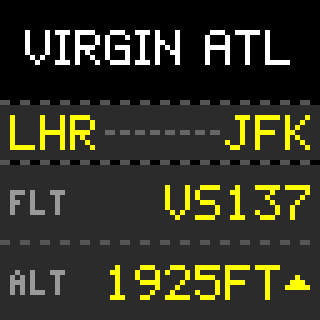
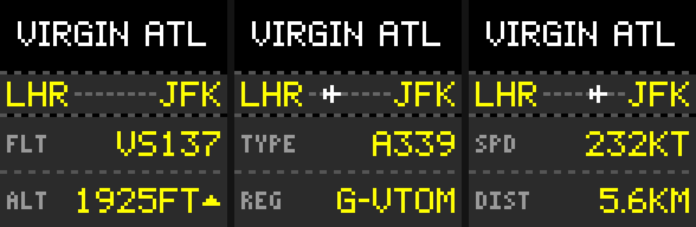

# Pixoo Radar

Shows the airborne flight closest to your home on a
[Divoom Pixoo64](https://divoom.com/products/pixoo-64): airline logo, route with an
animated plane, and a split-flap panel cycling flight number, altitude, aircraft type,
registration, speed and distance.

<p align="center">
  
</p>



*Rendered with `--preview`. Airline logos are switched off in these images
(`LOGO_SOURCES=none`); on the device the airline name is replaced by its logo.*

## Features

- **Closest flight, live**: polls FlightRadar24 every `REFRESH_SECONDS` within
  `RADAR_RADIUS_KM` of your location and shows the nearest airborne aircraft.
- **No "Loading.." screen**: with `GIF_BASE_URL` set, the app serves each animation as a
  GIF and the Pixoo fetches and plays it itself, so the picture just swaps in.
  Without it, frames are pushed over the Pixoo's API (works anywhere, shows "Loading..").
- **Airline logos** fitted to the 64×20 strip: backgrounds keyed out, thin strokes
  firmed up, dark logos lifted so they're visible on black.
- **Climb/descent arrows**, flight levels above 10,000 ft, km distance.
- **Browser view**: open `http://<host>:8765` to see exactly what the Pixoo is showing.
- **Self-diagnosing**: checks that the Pixoo can reach it, falls back to pushing frames
  if not, and says why in the logs.
- **`/health` endpoint** and a Docker `HEALTHCHECK`.
- **Runs anywhere**: multi-arch image (amd64 + arm64: PCs, NAS, Raspberry Pi), Compose,
  Swarm, Portainer, or a plain systemd service via `install.sh` (LXC, Pi, VM).

## Quick start

You need a Pixoo64 on your network and its IP address (Divoom app → device settings).

```sh
mkdir pixoo-radar && cd pixoo-radar
curl -fsSLO https://raw.githubusercontent.com/haythamelkhoja/pixoo-radar-enhanced/main/compose.yaml
curl -fsSL  https://raw.githubusercontent.com/haythamelkhoja/pixoo-radar-enhanced/main/.env.example -o .env
nano .env                  # set PIXOO_HOST, HOME_LAT, HOME_LON, GIF_BASE_URL
docker compose up -d
docker compose logs -f
```

Not using Docker? On Debian, Ubuntu, Raspberry Pi OS or a Proxmox LXC container:

```sh
curl -fsSL https://raw.githubusercontent.com/haythamelkhoja/pixoo-radar-enhanced/main/install.sh | sudo bash
```

Just want to try it without a Pixoo?

```sh
pip install -r requirements.txt
HOME_LAT=51.4700 HOME_LON=-0.4543 python src/pixoo_radar.py --preview ./preview
```

## Configuration

Everything is an environment variable. Only the first three are required.

| Variable | Default | Description |
|---|---|---|
| `PIXOO_HOST` | *(required)* | IP or hostname of the Pixoo64. Not needed for `--preview`. |
| `HOME_LAT` | *(required)* | Your latitude in decimal degrees, e.g. `51.4700`. |
| `HOME_LON` | *(required)* | Your longitude in decimal degrees, e.g. `-0.4543`. |
| `GIF_BASE_URL` | *(empty)* | Plain-`http` address where the **Pixoo** can reach this app, e.g. `http://192.168.1.20:8765`. Enables hosted GIFs (no "Loading.."). Empty = push frames. |
| `GIF_PORT` | `8765` | Port of the built-in web server (hosted GIFs, browser view, `/health`). |
| `RADAR_RADIUS_KM` | `100` | Search radius around home, whole kilometres. |
| `REFRESH_SECONDS` | `60` | How often to look for the closest flight. |
| `SHOW_GROUND_TRAFFIC` | `false` | `true` to include parked and taxiing aircraft. |
| `FRAME_MS` | `300` | Animation frame time in milliseconds. |
| `PIXOO_BRIGHTNESS` | `-1` | Set brightness `0`–`100` at start-up; `-1` leaves it alone. |
| `LOGO_SOURCES` | `fr24,avcodes` | Where to fetch airline logos, tried in order. `none` shows the airline name instead. |
| `COLOR_TEXT` | `#FFFF00` | Colour of flight details. |
| `COLOR_BOX` | `#2B2B2B` | Colour of the panels behind the text. |
| `TZ` | `UTC` | Timezone for log timestamps (Docker). |

More detail, examples and edge cases: [docs/configuration.md](docs/configuration.md).

## Deployment

All options in detail: [docs/deployment.md](docs/deployment.md).

### Docker

```sh
docker run -d --name pixoo-radar --restart unless-stopped -p 8765:8765 \
  -e PIXOO_HOST=192.168.1.50 -e HOME_LAT=51.4700 -e HOME_LON=-0.4543 \
  -e GIF_BASE_URL=http://192.168.1.20:8765 \
  ghcr.io/haythamelkhoja/pixoo-radar-enhanced:latest
```

### Docker Compose

[`compose.yaml`](compose.yaml) + [`.env.example`](.env.example), see Quick start.

### Docker Swarm

[`stack.yml`](stack.yml) publishes port 8765 in ingress mode, so it answers on every
node — that's where the Pixoo fetches its GIFs and where the browser view lives. No
reverse proxy, on purpose: the Pixoo can't do TLS or follow redirects.

```sh
docker stack deploy -c stack.yml pixooradar
```

### Portainer

*Stacks → Add stack → Repository*, URL `https://github.com/haythamelkhoja/pixoo-radar-enhanced`,
compose path `compose.yaml` (standalone) or `stack.yml` (Swarm). Set the variables under
*Environment variables*. Or paste either file into the *Web editor*.

### Bare metal / LXC / Raspberry Pi

[`install.sh`](install.sh) installs a venv in `/opt/pixoo-radar`, a settings file in
`/etc/pixoo-radar.env` and a `pixoo-radar` systemd service. Re-run it to upgrade.

## The Pixoo can't do HTTPS (or follow redirects)

The Pixoo64 fetches hosted GIFs over **plain http only**. It doesn't speak TLS, and it
**doesn't follow redirects**, so an `http → https` redirect (Traefik, Caddy, Nginx
Proxy Manager, Cloudflare...) makes the fetch fail.

So point `GIF_BASE_URL` at the **app's own port** (`http://<host>:8765`), not at your
reverse proxy. The proxy can still serve the browser view over HTTPS; the Pixoo just
goes around it. The app tests its own `GIF_BASE_URL` at start-up and warns you if it
redirects. See [troubleshooting](docs/troubleshooting.md#the-pixoo-cant-follow-http--https-redirects).

## Documentation

- [Configuration](docs/configuration.md)
- [Deployment](docs/deployment.md)
- [How it works](docs/how-it-works.md)
- [Troubleshooting](docs/troubleshooting.md)

## Disclaimer

- Flight data comes from **FlightRadar24's unofficial, undocumented web endpoints**
  via the [FlightRadarAPI](https://github.com/JeanExtreme002/FlightRadarAPI) package.
  This project isn't affiliated with or endorsed by FlightRadar24. Keep it to
  **personal, non-commercial use**, respect their terms, and don't lower
  `REFRESH_SECONDS` aggressively. The endpoints can change or stop working at any time.
- **Airline logos are fetched at runtime** (from FlightRadar24 and
  [Jxck-S/airline-logos](https://github.com/Jxck-S/airline-logos)), cached in memory
  only, and **never stored in or distributed with this repository**. They're
  trademarks of their respective owners.
- Not affiliated with Divoom.

## Credits

- Inspired by [chrivoge/PixooRadar](https://github.com/chrivoge/PixooRadar).
- [FlightRadarAPI](https://github.com/JeanExtreme002/FlightRadarAPI) by JeanExtreme002.
- Airline banners from [Jxck-S/airline-logos](https://github.com/Jxck-S/airline-logos).

## License

[MIT](LICENSE)
